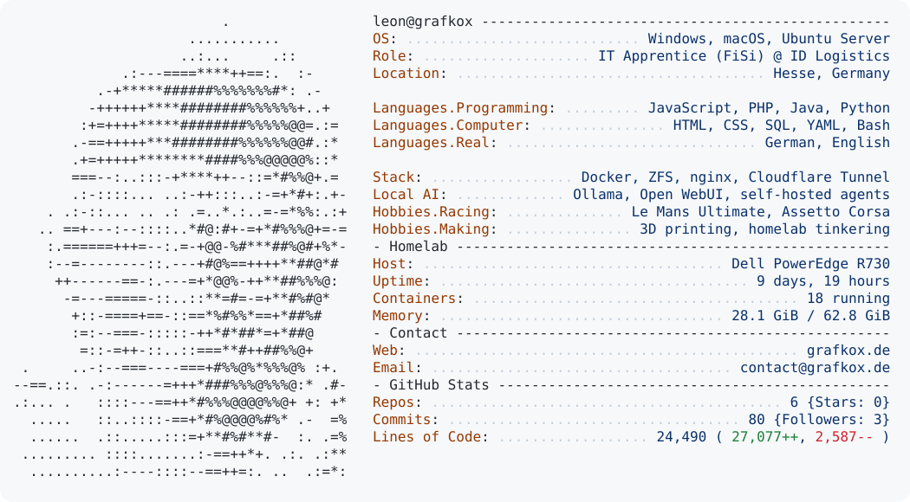

<a href="https://grafkox.de">
  <picture>
    <source media="(prefers-color-scheme: dark)" srcset="dark_mode.svg">
    
  </picture>
</a>

The card is regenerated every 3 hours by a <a href=".github/workflows/update.yml">GitHub Action</a>. The homelab numbers come from my server through a token-protected endpoint, see <a href="homelab/">homelab/</a>.
